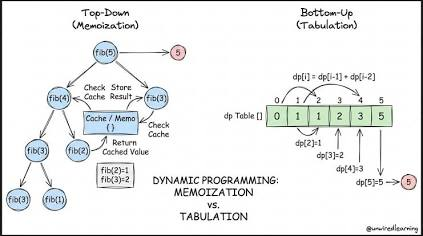
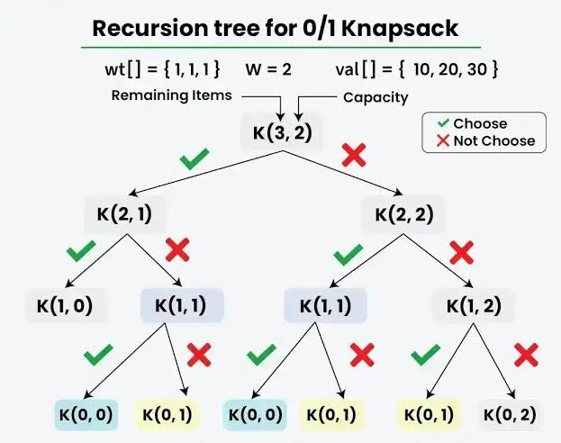

# Dynamic Programming (DP)

1. Akar Masalah: Masalah yang Tumpang Tindih (Overlapping Subproblems)
pada pendekatan rekursi naif, algoritma memecah masalah besar menjadi masalah yg lebih kecil. Untuk menghitung `fib(5)`, komputer harus menghitung `fib(4)` dan `fib(3)`. Namun, saat menghitung `fib(4)`, komputer juga harus menghitung `fib(3)` dan `fib(2)`

Komputer tidak memilki ingatan masa lalu. Ia akan menghitung `fib(3)` dari awal berkali-kali di berbagai cabang yang berbeda. Semakin besar angkanya, semakin banyak perhitungan sia-sia yang diulang. Ini menyebabkan ledakan percabangan eksponensial sehingga kompleksitas waktunya menjadi O(2ⁿ). 
Jika Kita mencoba menjalankan `fib(50)`, komputer Kita mungkin akan membeku (hang) karena harus melakukan triliunan operasi berulang.

2. Solusi: Memoization (Mengingat Masu Lalu)
Memoization (berasal dari kata memo atau catatan) 
teknik utama dalam Dynamic Programming dengan pendekatan Top-Down.

Ide dasarnya sangat sederhana. Gunakan "buku catatan" untuk mengingat setiap hasil perhitungan yang sudah pernah dilakukan.

Cara kerjanya:
- Sebelum menghitung nilai `fib(n)`, algoritma akan mengecek ke dalam buku catatan (biasanya menggunakan `Dictionary` di Python): "Apakah nilai `fib(n)` ini sudah pernah dihitung sebelumnya?"

- Jika SUDAH: Langsung ambil dan kembalikan nilainya dari catatan. Langkah ini terjadi secara instan atau 

- Jika BELUM: Hitung nilainya seperti biasa. Namun, sebelum memberikan hasil akhir, simpan dulu hasilnya ke dalam catatan agar jika nilai tersebut dibutuhkan lagi di masa depan, komputer tidak tidak perlu menghitung ulang.

3. Perbandingan Kompleksitas
Dengan mengorbankan sedikit memori RAM untuk menyimpan buku catatan, kita mendapatkan peningkatan kecepatan yang luar biasa:

- Waktu (Time Complexity)   : Turun drastis dari O(2ⁿ)(Eksponensial) menjadi O(n)(Linear). Ini karena setiap angka dalam deret Fibonacci (dari 1 sampai n) dihitung hanya tepat satu kali.

- Ruang (Space Complexity)  : Berubah menjadi O(n). Algoritma membutuhkan alokasi memori tambahan seukuran n untuk menyimpan data di Dictionary (catatan) dan untuk tumpukan pemanggilan funsi (Call Stack) di memori komputer.

# Tabulation (Bottom-Up)
Bottom-Up berarti kita membalik cara berpikirnya. Daripada memanggil fungsi dari masalah yang besar, kita justru menyelesaikan masalah paling kecil terlebih dahulu(dari "bawah"), menyimpannya di dalam tabel (biasanya `List` atau Array), lalu bergerak "naik" langkah demi langkah hingga mencapai masalah utama.

Karena kita berjalan dari bawah ke atas secara berurutan, Kita sama sakli tidak membutuhkan rekursi. Kita hanya butuh perulangan `for` biasa.

- Gaya penulisan: Iteratif (menggunakan loop).
- Kapan digunakan? ini adalah pendekatan DP paling optimal untuk produksi. Jauh lebih cepat, lebih aman (tidak ada batas rekursi), dan sangat hemat memori.
- Kelemahan: Terkadang sulit memikirkan urutan pengisian tabel dari bawah untuk masalah yang kompleks.

# Coin Chnage Problem 
satu kasus paling populer dalam ilmu komputer untuk membuktikan kelemahan algoritma Greedy dan keunggulan Dynamic Programming (DP).

Bayangkan Kita adalah seorang kasir. Kita memiliki persediaan koin yg tidak berbatas degnan pecahan tertentu (misalnya [1, 3, 4] ), dan Kita harus memberikan kembalian sebesar `6`. Tujuannya adalah mencari kombinasi jumlah koin paling sedikit untuk mencapai target tersebut.

## Mengapa Pendekatan Logika Biasa (Greedy) Gagal?

Jika menggunakan algoritma Greedy (selalu rakus memilih koin terbesar lebih dulu), komputer akan mencoba mengambil 4. Sisa kembalian adalah 2. Karena 3 lebih besar dari 2, komputer akan mengambil koin 1 sebanyak 2 kali

- hasil Greedy 4 + 1 + 1 = 3 koin.

- Hasil Optimal 3 + 3 = 2 koin.

Greedy gagal karena ia hanya melihat pilihan terbaik di detik itu (koin terbesar), tanpa memperhitungkan dampak jangka panjangnya terhadap sisa nilai. DP menyelesaikan masalah ini dengan mencoba dan "mengingat" setiap kemungkinan dari bawah ke atas (Bottom-Up Tabulation).

## Strategi Tabulation (Bottom-Up)

kita akan membuat sebuah tabel (List) dp dari indeks 0 hingga target. Setiap indeks mewakili jumlah kembalian, dan nilai di dalam indeks tersebut mewakili jumlah koin minimum yang dibutuhkan.

1. inisialisasi Tabel: Buat list dp berukuran target + 1. Isi semuanya dengan nilai "Tak Terhingga" (infinity), karena kita sedang mencari nilai minimum

2. Base Case: dp[0] = 0. Butuh 0 koin untuk mencapai nilai kembalian 0.

3. Rumus Transisi (Inti DP): Untuk setiap angka dari 1 sampai target, kita cek setiap koin. 
Jika nilai koin lebih kecil atau sama dengan angka saat ini, kita gunakan rumus:
dp[i] = min(dp[i], dp[i - koin] + 1)

# 0/1 Knapsack Problem (Masalah Ransel 0/1)
salah satu masalah optimasi paling ikonik dalam ilmu komputer

Bayangkan Kita adalah seorang pencuri yang menyelinap ke sebuah brankas. Ktia membawa sebuah ransel(knapsack) yang hanya mampu menahan berat maksimal terntentu (misalnya kapisitas 7 kg). Di depan Kita ada beberapa barang berharga, di mana masing-masing barang memiliki Berat(weight) dan nilai jual (value) yang berbeda.

Pertanyaannya: Barang mana sajayang harus Ktia masukkan ke dalam ransel agar total nilai jualnya paling tinggi, tanpa membuat ransel robek (Melebihi kapasitas berat)?

Angka "0/1" pada masalah ini merujuk pada batasan ketat: untuk setiap barang, Kita hanya punya 2 pilihan mutlak. Kita meninggalkannya (0) atau mengambilnya secara utuh (1). Kita tidak bisa mengambil stengah dari sebuah barang (seperti memotong batangan emas menjadi dua).

